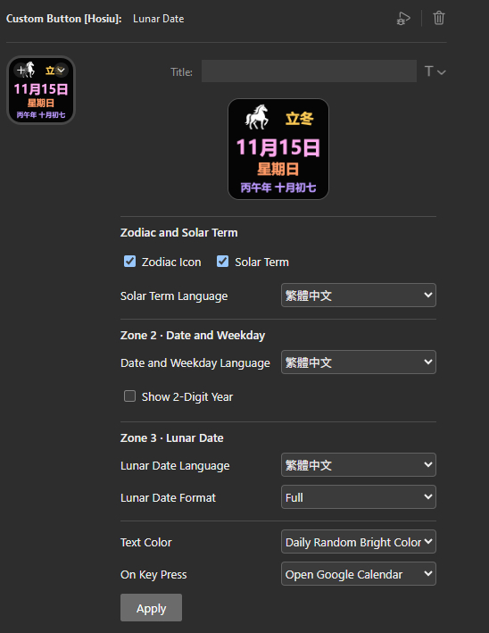

# Lunar Calendar for Stream Deck

A standalone Windows Stream Deck key for the Chinese lunar calendar. It renders a 512 × 512 PNG and refreshes on the first update after midnight in your Windows time zone. The key displays the latest solar term from its calendar day until the next one begins.


## Platform Support

The official release supports Windows 10 and 11 (x64) with Stream Deck 7.1 or later. Community macOS ports are welcome.

## Install

Use Windows 10 or 11 (x64) and Stream Deck 7.1 or later. Download `hosiu.lunarcalendar.windows.streamDeckPlugin` from the release Assets, double-click it, and confirm installation. Drag **Lunar Date** from **Custom Button [Hosiu]** onto a key. Select the key, change its settings, and click **Apply** to update the key and its preview.

- Zone 1 shows the zodiac and solar term side by side. If you hide either, the other is centered. Choose Traditional Chinese, Simplified Chinese or English for the solar term while it is enabled.
- Zone 2 shows date and weekday on separate lines. Choose Traditional Chinese, Simplified Chinese or English. With the two-digit year enabled, the date appears as `26年11月14日` in Chinese or `Nov 14, 26` in English.
- Zone 3 shows the lunar date in Traditional or Simplified Chinese with a full or short format.
- Daily random colors use four distinct colors from the original bright palette. Choose a preset or custom color to use one color for all text.
- Pressing the key opens Google Calendar by default. Choose **Open Outlook Calendar** when classic Outlook (`OUTLOOK.EXE`) is installed, or choose **Do Nothing**.

The calendar, settings and image rendering run locally inside Stream Deck. An internet connection is required to visit Google Calendar.



## Read the source

Inside `io.github.lunarcalendar.windows.sdPlugin/`, start with `plugin.cjs` to see how Stream Deck events connect to calendar rendering, per-key settings and Google Calendar.

| File | What it does |
| --- | --- |
| `windows-date.cjs` | Read the live calendar day directly from Windows, including new Windows time zones. |
| `local-date.cjs`, `calendar.cjs` | Read the date of a JavaScript test or sample timestamp and assemble the data for all three zones. |
| `gregorian-date.cjs`, `lunar-date.cjs`, `solar-term.cjs`, `zodiac-date.cjs` | Format each part of the calendar independently. |
| `render.cjs`, `render-*-zone.cjs` | Assemble the 512 × 512 key image and lay out each of its three zones. |
| `render-solar-term.cjs` | Fits the solar-term text beside the zodiac or centered in the top zone. |
| `daily-colors.cjs`, `text-svg.cjs`, `zodiac-image.cjs` | Choose daily colors, fit text and prepare zodiac artwork. |
| `outlook-path.cjs`, `calendar-action.cjs` | Detect classic Outlook and run the chosen calendar action. |
| `inspector.html`, `inspector.css`, `inspector.js` | Define the settings panel, its styling and the Apply and preview behavior. |
| `settings.js` | Defines and validates each key's settings. |
| `manifest.json` | Registers the plugin, the sidebar group and icon, and the Lunar Date action. |

`make-icons.cjs` at the project root generates the packaged icons and the example key image. The supplied Hosiu artwork is included at the project root for rebuilding the sidebar icon.

`pack.cjs` at the project root runs the Elgato packager and sets the distribution filename.

## Build on Windows

Use Node.js 24 and the [Elgato Stream Deck CLI](https://docs.elgato.com/streamdeck/cli/commands/pack/). Run each command from this project folder.

```powershell
npm.cmd ci --omit=dev --prefix io.github.lunarcalendar.windows.sdPlugin
```

```powershell
node pack.cjs
```

The installer is saved to `dist/hosiu.lunarcalendar.windows.streamDeckPlugin`. The build bundles the JS lunar calendar library and the x64 Windows PNG renderer. Stream Deck supplies the Node.js runtime at installation. To regenerate the checked-in action icons and sample preview after a design change, run:

```powershell
node make-icons.cjs
```

## Artwork and fonts

`io.github.lunarcalendar.windows.sdPlugin/zodiac/` contains 12 zodiac PNGs. Confirm their redistribution rights before publishing a public release. The key crops transparent padding and fits the artwork within 205 × 155 px. If an individual PNG is absent, the key uses the animal name instead.

### Build with your own zodiac pictures

1. Extract the source ZIP and open the folder containing `README.md`.
2. Open your BMP or other image in an image editor. Fit the artwork on a **300 × 300 px canvas**, matching the originals. Keep its proportions and use a transparent background so the animal blends into the key. **Export as PNG**. Changing the filename extension alone leaves the image in its original format.
3. Open `io.github.lunarcalendar.windows.sdPlugin/zodiac/`. Replace the corresponding PNG and keep its exact filename. For example, export a new horse picture as `horse.png`. Repeat for each animal you want to change.
4. Return to the folder containing `README.md`. Type `powershell` in File Explorer's address bar and press Enter. Run the two commands under [Build on Windows](#build-on-windows), one at a time. The first installs the required packages. The second bundles your replacement PNGs. You can skip `make-icons.cjs` for a zodiac-only change.
5. Open `dist/` and double-click `hosiu.lunarcalendar.windows.streamDeckPlugin` to install your build. Enable **Zodiac Icon** on your **Lunar Date** key. The picture shown is the one for the current lunar year.

For a local artwork swap in an already installed plugin, you can also replace the matching PNG in its installed `zodiac/` folder and quit and reopen Stream Deck to reload it.

The Windows renderer uses Microsoft YaHei Bold for both Chinese scripts when available, with a shared list of Windows fallback fonts. English uses Arial Bold.

Calendar calculations use [lunar-javascript](https://github.com/6tail/lunar-javascript), including leap months and solar terms. PNG rendering uses [resvg-js](https://github.com/thx/resvg-js).
